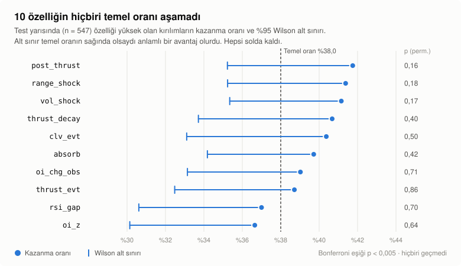

# Breakout Feature Lab

Kripto kırılımlarında "bu kırılım tutacak mı?" sorusuna cevap verdiği düşünülen 10 özelliği, ön-kayıtlı (pre-registered) bir istatistiksel testle sınayan araç.

> *English summary: a pre-registered falsification test of 10 breakout features on Binance USDT-M perpetuals. Chronological train/test split, triple-barrier outcomes net of fees, Wilson lower bounds, permutation tests with Bonferroni correction. Result: none of the 10 features beat the base rate.*

## Ne yapar?

Kırılım özelliklerini ölçen bir TradingView indikatörü kullanıyordum. Bu indikatör daha yüksek zaman dilimindeki (ör. 4 saat) seviyenin kırılmasını yakalıyor ve kırılım anındaki özellikleri ölçüyordu: hacim şoku, fiyat aralığı şoku, open interest değişimi, RSI farkı gibi. İndikatör bu repoda yer almıyor.

`bfl_test.py` aynı formülleri Binance perpetual verisi üzerinde Python ile birebir yeniden kurar ve her özelliği tek tek test eder:

| Adım | Yöntem |
|---|---|
| Seviye | Kapanmış HTF mumlarının en yükseği (repaint yok) |
| Olay | Seviyenin üstündeki ilk düşük zaman dilimi kapanışı |
| Sonuç | Triple barrier: ATR cinsinden TP/SL, maksimum bekleme süresi, işlem ücreti dahil |
| Test | Kronolojik ikiye bölme. Eşikler ilk yarıda belirlenir, ikinci yarıda test edilir. |
| İstatistik | Wilson alt sınırı, 5.000 tekrarlı permütasyon testi, Bonferroni düzeltmesi |
| Ön-kayıt | Tüm parametreler `CONFIG` içinde sabit. Config hash'i rapora yazılır, komut satırından değiştirilemez. |

Ayrıca `--selftest` modu var. Bu mod sentetik veriyle ileriye bakma (lookahead) hatası ve null kontrolü yapar.

## Sonuç

<picture>
  <source media="(prefers-color-scheme: dark)" srcset="docs/results-dark.svg">
  
</picture>


60 USDT perpetual sembol, 4 saatlik seviye, 5 dakikalık işlem, son 29 gün:

- **1.093 kırılım olayı** (546 eğitim, 547 test)
- Testteki temel kazanma oranı: 0,380. Ücretler düşüldükten sonra ortalama R: −0,228.
- **10 özelliğin 10'u da testi geçemedi.**

Ayrıntılar için `results/report.md` dosyasına bakabilirsin. Grafik `docs/make_chart.py` ile `results/feature_tests.csv` dosyasından üretiliyor.

Olumsuz bir sonuç da bir sonuçtur. Bu test, iyi görünen bir indikatörün gerçek bir avantaj sağlamadığını, işlem yapılmadan önce ortaya çıkardı.

## Çalıştırma

```bash
pip install -r requirements.txt
python bfl_test.py --selftest                 # sentetik veriyle kontrol
python bfl_test.py --top 60                   # 24 saatlik hacme göre ilk 60 perpetual
python bfl_test.py --symbols SOLUSDT,WIFUSDT
```

Veri Binance'in genel API'sinden çekilir, API anahtarı gerekmez. İndirilen veri `bfl_cache/` klasörüne kaydedilir ve 24 saat boyunca tekrar kullanılır.

## Nasıl geliştirildi

Test tasarımı, özellik seçimi ve doğrulama kuralları bana ait. Kod [Claude Code](https://claude.com/claude-code) ile yazıldı.

Yatırım tavsiyesi değildir.
